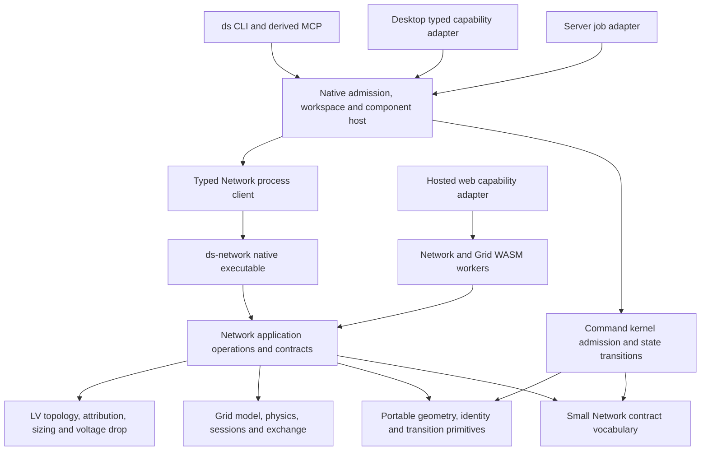

# DS Network modularization: shared Rust core, native executable and browser WASM

Owner request: 13 October 2026. Canonical planning owner: `ds-command-kernel/backlog/`.

Execution host correction, owner 14 October 2026: author and land this backlog through `ssh ds-server` on canonical `run`. Windows source checkouts are pull-only; Windows installed-product/native validation remains a separate authorized activity. This plan was adapted to server Kernel baseline `1328b49a5d7ea52f79e0705610403c2ff5b5e851`, preserving the concurrent source edits and newer Reporter/Solar host-control/update obligations. The inspection hashes below describe the earlier source audit, not current server implementation or release proof. Recheck live heads in N0.

This is the next Network modularization campaign, reopened by the owner after the 10 October ruling limited independent releases to Reporter and Solar. The owner subsequently authorized implementation, local release/deployment and installed acceptance on canonical `run`, and autonomous continuation until the Network executable extraction is complete. Project designs and submission files remain outside this campaign. Entire command-kernel extraction remains separately scoped.

Owner scope correction, 14 October 2026: the interactive DS Grid Profile/Design editor migration and containerization are deferred to [the parked obligation](hardproblems/OPEN.md#interactive-ds-grid-profiledesign-extraction). Preserve its current editing behavior and disclose its remaining linked engineering dependencies. This campaign continues the offline backend operations, native LV Desktop path, shared contracts and independent component build/update/rollback release. A backend release is not proof that the entire Desktop is extracted.

The target is an independently buildable and updateable **`ds-network.exe` on Windows, `ds-network` on Linux, and one lazily loaded engineering WASM unit in hosted web**, all using the same Rust domain implementations. Hosted web separately carries permanent Kernel and Interactions WASM; section8 records the latest owner boundary. A native Desktop operation must reach the admitted executable, not an engine linked into the host or a WASM instance inside WebView2. Existing browser-only operations remain explicit WASM capabilities. The supported human/operator/agent commands remain `ds` and its derived MCP projection.

## 1. What counts as uncoupled

There are four separate obligations. A filename or a second repository alone satisfies none of them.

| Obligation | Required proof |
| --- | --- |
| Semantic independence | Equivalent typed inputs call the same Rust algorithms; no native/WASM/TypeScript fork of defaults, cleaning, topology, sizing or engineering decisions. |
| Runtime independence | Desktop, CLI and Server start/use an admitted Network process. Its crash cannot corrupt the host, silently change project context or destroy the last durable checkpoint. Hosted web uses admitted WASM in the appropriate worker/runtime boundary. |
| Build independence | The Network release builds from its captured dependency closure without a mutable sibling checkout. Unrelated web/kernel/reporter edits do not invalidate that closure. The portable kernel builds without Network present. |
| Release independence | A compatible Network-only patch can be installed without rebuilding/reinstalling unchanged Desktop, CLI, Server, Reporter or Solar. An unrelated host release reuses the admitted engine artifact. Native and browser assets have explicit compatibility and source pins. |

Pure contract/primitive libraries can remain pinned build dependencies. That is not runtime coupling. Path dependencies to mutable siblings, domain crates embedded in consumers, whole-stack release-vector admission and copied unverified algorithms are coupling. A genuine public contract change can require a coordinated release; an unrelated source change must not.

Campaign completion requires all four proofs for the declared operation inventory. A migrated LV path is a useful first vertical, not a claim that the entire workspace is independent.

## 2. Source evidence and lessons to retain

### 2.1 Local inspection boundary

Planning inspection used clean canonical checkouts at these commits; recheck heads and occupied files before implementation:

| Repository | Inspected commit |
| --- | --- |
| ds-web | `de251291eea89beab653701a806a55ee697eb736` |
| ds-network | `13081a0637738e911b91cb0bd015a6fca6a9ea9a` |
| ds-command-kernel | `9dbdad948fbdf8cb5588f5d07ded39ec92b3b389` |

This plan uses DS's recorded GeoLibre lessons. It does not claim a fresh upstream GeoLibre audit or current upstream behavior. `ds-web/docs/cesium-main-map-contract.md` records the specific upstream reference `b70e13d489d882af2715177cbfd08f872ea0fa0e` for renderer/lazy-loading lessons; that is not a pin for an entire new integration. If a future slice needs additional upstream behavior, record its exact inspected release/commit and derive local DS fixtures; do not introduce a GeoLibre runtime/CI dependency.

Read these local sources first (after current workspace/repository/scoped AGENTS.md and the shared collaboration agreement):

- [OpenGeos feedback-loop research](../docs/agent-guidance/research/opengeos-feedback-loops/README.md): apply source-anchored lessons through one bounded consumer repair and retained evidence.
- [GeoLibre learning index](../../ds-web/docs/investigations/geolibre-learning/README.md) and [post-extraction verification matrix](../../ds-web/docs/investigations/geolibre-learning/post-extraction-stabilization/VERIFICATION-MATRIX.md): separate contracts, source/build closure and runtime/release independence; use exact accepted evidence and extraction-first consumer checks.
- [GeoLibre roadmap lens](../../ds-web/docs/roadmap/README.md): borrow ideas through DS ownership, pooled computation, local-first storage and the existing layer model.
- [Native analytics plan, section 10](../../ds-web/docs/roadmap/NATIVE_DUCKDB_ANALYTICS_IMPLEMENTATION_PLAN.md#10-geolibre-cheat-sheet--borrow-behavior-not-architecture): coherent entry points, source/version provenance, ordinary result layers, capability-aware absence and explicit placement; no copied plugin/data/runtime architecture.
- [Pain ledger](../../ds-web/docs/PAIN_HISTORY.md): main-thread full-network freezes; quadratic graph/index work; row-by-row intake; separate table engines; poisoned asset caches; loss of independent model sessions.
- [WASM thread contract](../../ds-web/docs/wasm-performance-and-thread-boundary-contract.md): saved-room Desktop LV processing is native, hosted web is pooled WASM, bounded synchronous interactive operations remain a distinct category.
- [Desktop runtime contract](../../ds-web/docs/desktop-runtime-boundary-contract.md): presentation surface, structural capability, readiness/authority and execution placement are four different facts.
- [Network access contract](../../ds-network/docs/contracts/access-surface-architecture.md): one typed operation authority, `ds`/MCP public access, no host-specific algorithms or generic-argv escape hatch.
- [Native parallelism](../../ds-network/docs/contracts/native-compute-parallelism.md): synchronous CPU core, explicit host I/O, Rayon per compiled instance and existing batch cancellation semantics.
- [Portable geometry](../docs/contracts/ds-portable-geometry.md): canonical Lite primitives already live in Kernel; remaining snapshots have exact manifest/drift fences. Do not reverse this dependency or discard those fences prematurely.
- [Columnar contract](../../ds-network/docs/contracts/columnar-format-contract.md) and [cleaning execution](../../ds-network/docs/contracts/lazy-execution.md): Arrow IPC chunks and bounded previews, not another universal JSON table engine.
- [Backlog principles](PRINCIPLES.md): one coherent slice per repository on `run`, preserve concurrent work, prove/commit/push before the next, and keep result views/downloads working.

### 2.2 GeoLibre lessons translated into extraction obligations

| Recorded lesson | Consequence for Network extraction | Proof |
| --- | --- | --- |
| Coherent Add Data/navigation, distinct source owners | Preserve one visible workflow while dispatching through typed capability ports. Do not make the executable a universal loader or move every GIS subsystem into Network. | Existing source roles still select their real owner; operation descriptors name supported input/output roles. |
| Native/external results become ordinary layers | Process results and native model projections retain central layer identity/order/style/table/selection/export behavior. | A native result can be inspected, shown, styled and downloaded without a Network-private panel/store. |
| Inspect immutable source/version before use | Component and calculation inputs carry exact source, configuration and engine pins. | Stale source or incompatible component refuses before calculation/apply; no mutable `latest` execution. |
| Capability-aware absence | Missing executable, missing browser operation or unsupported native-only format is an actionable typed state. | No dead success response, no silent WASM/native/cloud fallback, no `isDesktopShell()` domain branching. |
| Large vectors should retain a columnar data plane | Use Arrow IPC, opaque model bytes and binary artifact transfer; bounded JSON for control/preview. | Large input/output crosses adapters without full feature-array expansion or base64 copies. |
| Platform asymmetry is legitimate | Native can use granted paths and native codecs; web accepts supplied buffers/handles. Same admitted domain operation retains semantics; capabilities need not be identical. | Capability matrix distinguishes supported/unsupported operations and codecs without a second implementation. |
| Borrow behavior, not architecture | No GeoLibre model import, plugin marketplace, Python/Pyodide stack, arbitrary SQL or generic executable downloads. | Build/runtime/CI dependency closure contains only admitted DS and professional-component dependencies. |
| Multiple maps/models must not multiply computation | Viewports remain view-only consumers. One model/session belongs to its admitted worker/process and durable checkpoint. | Multi-map layouts do not spawn a process/WASM instance per pane or displace another open model. |

## 3. Current coupling to remove, rather than recreate

The following are observed manifest/source edges, not claims that every operation has already been traced:

| Current edge | Concrete evidence | Required replacement |
| --- | --- | --- |
| Tauri embeds engineering and format crates | `ds-web/src-tauri/Cargo.toml` links `ds-network`, `ds-grid-engine`, `ds-grid-exchange`, `ds-geo`, `ds-io`, `ds-columnar`, `ds-elevation`. `native_compute.rs` directly calls native LV processing inside `spawn_blocking`. | Admitted engine client for domain compute/exchange; retain only explicitly classified portable contracts/host services. Remove domain links when that operation's process path is proven. |
| CLI embeds Network/Grid | `ds-cli/Cargo.toml`, `crates/ds`, `ds-cli-design`, `ds-cli-data`, `ds-cli-dsgrid`, `ds-cli-map`, exchange/library/PLS adapters link workspace domain/format crates. `lv/process.rs` decodes and invokes native LV processing directly. | `ds` maps declared inputs to the shared protocol and transports validated owner results; no embedded alternative engine. Inventory direct and transitive links, not just one manifest. |
| Native kernel-host crates invoke algorithms | `ds-compute-runtime` directly invokes native LV processing. `ds-design-workspace` links Network and Grid and runs processing/publication preparation. `ds-profile-runtime` embeds engine/exchange/model/physics. | Kernel retains admission/job/state/publication rules; native host crates invoke Network and validate pinned results. Profile calculation/session semantics remain Network-owned. |
| Client code links Network for small contract facts | `ds-client-core` links Network; transformer analysis re-exports method/schema constants and save code uses native LV processing types. | Small versioned Network contracts package, not the entire algorithm dependency tree. Do not duplicate strings/structs in host code. |
| Portable kernel has residual Network snapshots | `vendor/ds-geo-lite/MANIFEST.json` includes identity/comparison/canvas and processor catalog material; canonical geometry primitives already reside in Kernel. | Move only justified portable authority to canonical Kernel crates; retain drift fences until callers and exact parity are proven. Processor catalogs remain domain-owned and are distributed/pinned through a declared contract. |
| Reporter embeds some Network engineering | Reporter Cargo manifest links Network/Grid/exchange/profile plus cleaning/IO/geo/tiles. | Keep format/shared library edges classified. Fresh engineering re-evaluation uses admitted Network operation; Reporter consumes saved analysis without resizing/reprocessing by default. Do not pull workbook/PDF rendering into Network. |
| Browser wrapper is broader than engineering | `ds-network-wasm` wraps cleaning, geometry/session/table/projection, canvas, IO and LV compute; `ds-grid-wasm` owns worker-affine Grid sessions. | Classify exports. Application transitions stay with Kernel; transient UI algorithms move to Interactions. Consolidate engineering adapters into one lazy engineering WASM unit with real consumer and native/WASM parity proof. |
| Component identity exists without independent admission | `desktop-components.json` Network row is bundled-native with empty lifecycle/dependencies/artifact pins and no install descriptor. | Versioned verified native/WASM artifacts, real dependency closure, capability handshake, activation/rollback and truthful readiness. A component card alone is not extraction. |

Before editing, produce a machine-readable operation/dependency inventory from Cargo metadata, manifests, imports, current CLI descriptors, native command registry and WASM exports. Include build scripts, `include_*`/`#[path]` references, release scripts and tests. The inventory must distinguish observed operation coverage from guessed ownership.

## 4. Destination and dependency direction



The diagram is a semantic/build direction, not permission for the pure application layer to open OS files or contact a service. Pure algorithms receive admitted values/bytes. Native file/codec adapters surround them inside the executable or an explicitly classified host package. WASM receives supplied bytes. Kernel code never calls the Network executable or a browser API itself; native runtime adapters do that.

### Proposed package roles

| Package/role | Destination and purpose |
| --- | --- |
| Existing `ds-network` library and Grid domain crates | Keep domain algorithms/model/physics/exchange/session authority in the Network repository. Narrow dependencies where needed; preserve canonical APIs while consumers migrate. |
| `ds-network-contracts` (new, proposed) | Network-owned, serde/schema-only vocabulary: operation IDs, request/result/event schemas, engine identity/capabilities and existing analysis/model contract types needed by callers. No HTTP, filesystem, Polars, Tauri, Rayon scheduler, kernel core or domain algorithm dependency. |
| `ds-network-application` (role; separate crate only if needed) | One typed dispatch surface over existing domain operations. Descriptors derived from owner types, not hand-copied CLI or WASM catalogs. Separate dispatch from native file loading. |
| `ds-network-native` (new, proposed) | Native adapter crate with `[[bin]] name = "ds-network"`; produces `ds-network.exe` on Windows. Framing, declared file/codec adapters, engine execution and artifact emission; no cloud credentials or project publication. |
| Existing `ds-network-wasm` and `ds-grid-wasm` | Current portable adapters over the same application/domain operations. Migrate real consumers into the single lazy engineering WASM target; remove replaced exports after consumer proof. Worker/session affinity remains explicit within that engineering unit. |
| `ds-network-client` (role in native host infrastructure) | Process transport/admission/result checking, owned alongside existing component/process supervision. Depends on contracts, not algorithms. Reuse Reporter/Solar lifecycle machinery where its guarantees fit; no second updater. |
| Kernel core and Lite crates | Deterministic cross-client command/state transitions and justified portable primitives. Feature-gated, no reverse dependency on full Network, no domain calculation merely to avoid IPC. |
| Native kernel runtime/store/workspace packages | Own authenticated input admission, durable jobs, revision fences, queues, local storage, publication and wake events. Call Network through the client; do not inherit a dependency on engineering through a DTO. |

A host may use a pure schema/model-contract library without embedding computation. Every retained shared package must have a written reason and its actual transitive closure checked. An unchecked `ds-grid-model` dependency can pull model/Arrow code back into the host; do not label it contracts-only without evidence.

## 5. What moves to Kernel, and what must stay out

Move on evidence, not on file size or repository convenience. A candidate moves only when (a) it is portable deterministic behavior rather than engineering, (b) it immediately serves a native `ds` operation and the browser, (c) it removes an existing duplicate rule/implementation, and (d) the kernel can build without the Network workspace.

| Candidate | Decision for this campaign | Migration proof |
| --- | --- | --- |
| Geometry/index/corridor/vector primitives already canonical in `ds-geo-lite` | Retain Kernel ownership; Network consumes the pinned portable package. Do not undo completed canonicalization. | Existing numerical/packet yardsticks and isolated-kernel build remain green. |
| Generic identity/comparison/selection predicates; small bounded canvas geometry | Audit remaining snapshots and direct consumers; move canonical authority to small Kernel/Lite packages only when the evidence gate is satisfied. | Native/WASM fixture equality, source manifest replacement, old implementations/copies removed, no domain dependency. |
| Generic mutation plan, selector qualification, preservation comparison and optimistic revision transitions | Candidate Kernel operations. Layer-qualified identity must remain explicit; use shared rules for CLI and UI. | Same preview/count/refusal/apply decisions, stable provenance and preserved legacy source IDs; remove replaced TypeScript/native rules. |
| Compute placement, job admission, capacity decision, lifecycle, input fencing, cancellation/result acceptance | Keep/complete Kernel rule ownership; I/O/process handles remain in host runtimes. | Same answers across native/browser adapters with explicit capability inputs, no surface sniffing and no publication side effect from observation. |
| Domain request/result/analysis schema vocabulary | Put the small DTOs in Network contracts; Kernel can consume those pinned DTOs where needed. Do not move equations or model validation into Kernel to break a Cargo link. | Host build no longer needs Network algorithms; generated schemas match serde owner types. |
| LV graph build, snap/topology, pole/cable/material attribution, engineering cleaning, sizing and VD | Keep Network ownership. Generic scalar coercion may be separated only if it does not smuggle project/domain defaults. | Existing Network tests and shared-input native/WASM parity; no status/type inference added by adapters. |
| MV model/revision semantics, structural analysis, spotting, capacity interpretation and profile calculated state | Keep Network/Grid ownership. Kernel owns authorization/workspace publication fences, not physical interpretation. | Worker/session affinity, input tokens, revisions, engineering outcomes and schema5 model bytes preserved. |
| Table filtering/sorting/profiling/IPC mechanics | Inventory first. Portable predicates may move; the columnar/data engine stays at one owner and all tables reuse it. Do not move Polars wholesale into Kernel. | Shared `ColumnarTableSource` behavior; no JSON-only duplicate table kernel or host-specific filter answers. |
| File archives, native path handling, PLS tools, terrain/provider downloads | Classify codecs vs privileged host effects. Pure byte codecs can remain pinned packages. OS/process/provider authority stays in native host adapters. | Browser handle/path-like strings never grant native access; no HTTP/auth inside pure computation; known codec capabilities explicit. |
| MapLibre/Cesium/DOM, Svelte stores, IDB/OPFS persistence, WebView lifecycle | Keep host/UI ownership. Only deterministic transition rules move. | One component tree, existing layer registry and result views/downloads remain usable; no storage engine rewrite required. |
| XLSX/PDF/print composition, report supply/existing quantities and publication | Keep Reporter and publication owners. Network supplies explicitly requested engineering/analysis artifacts. | Reporter does not resize a saved design; quantity-only export does not acquire unrelated media or launch a hidden Network rerun. |

For each actual movement record source symbol/path, current consumers, destination, invariants, reference fixtures, dependency delta, generated API changes and deletion targets. Reject "move everything generic" as a work item.

## 6. One closed typed operation protocol

The protocol is internal engine transport; `ds capabilities` remains the public command authority. Describe fields from owner Rust types and project the relevant schema into CLI/MCP/WASM. Do not create a competing command registry, arbitrary function-name dispatcher, shell command API or generic argv forwarding.

### 6.1 Handshake and identity

Before executing, the client verifies the selected immutable package's provenance/digest and obtains engine identity:

- protocol family/major/minor and operation-specific contract revisions;
- component version, build/source/dependency-closure identity and executable/WASM digest;
- supported operations, input/output formats and schema versions;
- native or WASM execution environment and actual scheduling/capacity facts;
- supported session/checkpoint and calculated-state compatibility;
- declared bounds and refusal vocabulary.

Identity is read from the running admitted engine, not borrowed from a different standalone binary or the host's compile-time version. A compatible minor addition must not force all consumers to upgrade; an unavailable operation or incompatible major refuses before work. Record an operation capability set/digest rather than depending only on one marketing version.

### 6.2 Request, event and result vocabulary

Define a closed typed request envelope with request/job ID, operation+contract, immutable input/config/source references, explicit options, expected revision/input tokens and selected output projection. Authenticated project/principal/lane/context is admitted and retained by the host. An echoed context field inside engine JSON is never proof of authority.

Control events carry the request ID, sequence, real stage/progress units, warnings and typed terminal outcome. Distinguish transport success, computation completion, engineering verdict, local retention, save and publication. A successful computation can report an incomplete engineering verdict. Never turn "not calculated" into zero voltage drop/compliant, a missing layer into empty, or a failed producer into a successful published artifact.

Results include semantic input/config digests, engine identity, existing processed/model/calculated-state pins, deterministic output digest and complete artifact descriptors. The host verifies all declared outputs before retaining/applying them. Unknown fields needed for completeness, duplicate terminal events, mismatched request IDs, truncated streams, invalid lengths and digest failures are typed failures; they do not trigger a fallback engine.

### 6.3 Transport and bulk data

- Use bounded structured stdin/stdout control framing; stdout is protocol only, stderr bounded diagnostics. Reuse the existing component transport if it supports progress/cancel/multiple binary outputs safely; otherwise specify one length-delimited framing format. Do not add a listening localhost HTTP server merely to spawn an executable.
- Keep GeoJSON request/result compatibility for existing bounded LV packets while introducing binary attachments through the owner operation. Do not silently change saved JSON serialization or content digests as an extraction shortcut.
- Bulk layers/tables use existing Arrow IPC; native model/exchange output uses opaque `.dsgrid`/artifact bytes. Native file attachments refer only to host-admitted private job staging, with size/digest checks and safe destination ownership. Browser transfers buffers/handles, never native paths.
- No full-network base64 JSON, per-feature IPC message loop, complete feature arrays in UI previews, or double encoding through a JSON string inside JSON.
- Declare total/control/frame/artifact/session bounds from baseline workload evidence and existing operation limits. A smaller new arbitrary limit must not turn a currently admitted real transformer/model into a refused one.
- Native output staging is atomic and no-overwrite where the public operation already promises it. A terminal response follows complete verified output staging; stray partial files are not deliverables.

### 6.4 Determinism and compatibility

Keep existing `.dsgrid` schema5; it is the final breaking schema bump. No schema6 for process extraction. Extend transport metadata compatibly and keep engine/protocol identity separate from authored model identity. Preserve existing opaque assets, stable source IDs, external-library pins, calculated-state input tokens, floating-point round-trip behavior and canonical serialization.

Use byte parity for artifacts that already promise exact deterministic bytes. Exclude host paths, wall-clock timings and runtime diagnostics from semantic artifact comparisons only through an explicitly documented existing/proposed envelope separation, never by weakening the artifact test. Numerical tolerance is allowed only where the existing domain contract allows it; do not hide drift through a blanket tolerant comparison.

Changing the Polars version or IPC backend is an independent gated decision. Current Network manifests describe a WASM-safe0.53 line and native Arrow readers; the backlog requests0.55. Resolve the actual target dependency/codec compatibility before that change. Do not mix an unproven dataframe upgrade into native process extraction or pull native Arrow/Tokio networking into `wasm32-unknown-unknown`.

## 7. Native lifecycle, state and concurrency

### 7.1 Stateless LV and persistent Grid work

Start with a bounded stateless LV processing invocation: exact current request/config in, canonical complete result out. Reuse it from CLI, Desktop and Server. A child does not read a saved global project selection, remote credentials, cloud config or private host database. File-backed input capture is a host adapter, not a new source of engineering defaults.

MV/Profile sessions need worker/process affinity. Use an explicit session identity and lease tied to exact engine version and model/input token. All dependent commands for a session reach the same owner. Keep every open model's durable checkpoint independent; a single active model ID must not overwrite other models. Read-only projections must not advance authored state, queue publication or reconstruct a different model behind the UI.

The process is allowed to lose ephemeral caches on crash. It must not lose the last acknowledged host-owned durable checkpoint. A restart reopens exactly that checkpoint and revalidates engine/calculated-state compatibility. Do not claim automatic replay of a partially applied edit until journal/event semantics prove it is idempotent and revision-fenced. Explicit retry can recompute a pure operation from unchanged captured inputs; save/publication retries use the existing durable idempotency/fencing owner.

### 7.2 CPU, memory and cancellation

The native engine remains synchronous CPU code. Async host orchestration/I/O crosses a blocking/process boundary; Rayon performs independent CPU work. No CPU-heavy kernel runs on Tokio event workers, no pool per request, no separate Tokio CPU pool stacked over Rayon.

Reproduce the current admission rule before optimizing: Desktop LV processing reserves768MiB per admitted job, keeps1GiB OS reserve, caps concurrent residency by available CPUs/memory and admits at most two jobs when memory cannot be read. These are current documented inputs, not a recommendation to multiply that reservation per pane or change it during extraction.

An executable changes the scheduling geometry: launching N children each with all logical CPUs would oversubscribe the machine. Choose one explicitly tested model in the first native vertical: a bounded batch inside one shared engine process/pool, or capped child pools under one host budget. Report aggregate admission and per-engine pool width. Preserve input order, row-level failure isolation and existing speculative-result/cancellation semantics. Requested parallelism must be honored up to admitted capacity or truthfully report the effective cap; do not silently advertise a width while running serially.

Cooperative cancellation retains completed outputs permitted by the current operation and marks/discards later speculative outputs consistently. Add bounded cancel acknowledgement and process-tree reap/kill fallback for a hung engine. A killed process yields no fabricated terminal result. Separate acquisition, startup/handshake, execution, cancellation and artifact-staging deadlines. Closed stdin, parent exit and explicit shutdown must not leave orphan workers.

### 7.3 Updates during work

An active job/session keeps its captured executable path and digest. Never overwrite an executable while it is running or redirect an active session to a new engine. Acquire/verify into a versioned directory; atomically select the next compatible unit only for new jobs. Retain an immediately usable previous unit and complete dependency closure. Defer incompatible updates that require a host restart; preserve unsaved edits, local model checkpoints, credentials, outboxes and report publication queues.

Use event-driven completion/update/wake signals and kernel deadlines. Do not add periodic queue scans, per-component tray owners or retry timers that reinterpret authority. Component unavailability and reactivation must remain scoped by account/install/lane/project. Explicit component check/navigation/push-driven update behavior reuses the existing release contract.

## 8. Browser WASM lifecycle and package boundaries

**Owner refinement, 2026-10-14:** the target is exactly three browser WASM
units: Kernel orchestration and neutral Interactions are permanently available;
Network engineering is loaded when processing is requested or deliberately
imminent. Its computation crates also compile into the native Network addon.
The owner created `ds-interactions` for permanent UI-only ownership. Transient
map hit testing, screen-space snapping, selection gestures, viewport and canvas
interaction indexes must depend on neither Kernel nor Network engineering and
must not enter CLI or Server dependency closures. Neutral shared primitives
remain separately classified. See the
[interaction boundary](../../ds-interactions/docs/interaction-boundary.md).
Current Network/Grid packages and unconditional browser startup are migration
inputs, not evidence that the three-unit target is implemented. This mechanical
extraction does not reopen the parked interactive Grid/Profile redesign.

The web compiles the same application/domain crates with a portable feature closure. Heavy process/import/clean/table/convert/profile work stays in the existing bounded worker ownership. Ordinary WASM has one internal Rayon worker; Web Worker concurrency supplies parallelism. There is no requirement for shared-memory WASM threads or cross-origin-isolated hosting in this campaign.

Keep cheap bounded synchronous pick/snap/interactive-index work synchronous while moving its single implementation and real consumers to Interactions. Moving every export to a worker can break synchronous interaction just as putting full processing on the main thread freezes it. Classify each export by domain owner, stateless/stateful, worker/main-thread, data shape, maximum admitted input and consumer. Shared neutral primitives and application transitions have distinct owners; do not import the full compute facade on the first map frame. Prove zero engineering loads for ordinary map movement, selection and snapping.

Retain warmup/idle teardown, worker-affine sessions, buffer transfers and explicit progress/cancel behavior. Worker startup/instantiate/version failures are visible; no silent main-thread, native or cloud fallback. Killing a WASM worker to cancel a synchronous run discards its ephemeral session and restores only the last durable checkpoint under existing ownership rules.

Publish immutable versioned packages with `.wasm`, JS glue, declarations and descriptor/schema inventory from the same source closure. Existing `@ds-platform/network` and `@ds-platform/grid` are consumer package boundaries, not reasons to split algorithms. A compatible browser package update can advance its verified manifest without rebuilding unrelated app code only if export/protocol/host compatibility is proven; a changed import/export contract legitimately requires a compatible frontend build.

Respect browser CSP/CORS/content types and the established origin/pinned artifact mechanism. Do not add arbitrary remote WASM downloads. Cache by immutable digest/version; activate the full JS/WASM pair, not one file. Mixed glue/module versions, stale service-worker/app asset references and interrupted acquisition must produce explicit failure/recovery. Do not re-enable root-scope Desktop service-worker caching to distribute an engine.

### Remaining UI consumer and retirement edges

Cold Interactions consumer proof and full application startup proof are separate
gates. Repeat ordinary map open/move/click/snap with retained layers and nonempty
tables; an empty map proves neither mounted edit-session behavior nor every
synchronous feature consumer. Keep explicit processing entrypoints admitted after
removing eager application bootstrap. Do not add a TypeScript fallback.

| Pending edge | Exact owner/caller | Required closure |
| --- | --- | --- |
| Open-table identity lookup | Web `selection/coordinator.ts` -> `wasm/ds-network.ts::dsNetworkFindFeatureInTabsSync` -> Network WASM `find_feature_in_tabs_v2`, owned by `crates/ds-geo/src/selection.rs` | Application identity/domain/preference semantics retain their admitted owner. Empty-table bypass is only an unused-data control; migrate the nonempty-table decision and prove click identity/order. |
| Retained edit-session UI index | Web `editing/session-index.ts` -> Network `SessionHandle` in `crates/ds-network-wasm/src/lib.rs` -> `crates/ds-geo/src/session.rs`; `editing/edit-context.ts` preloads Network and warms compute on temporary-edit entry | Separate transient pick/hover/snap/index from authored edits, selection state, undo and DataFrame admission. Preserve one synchronized geometry basis; no copied permanent index. Parked Grid/Profile redesign remains separate. |
| Other synchronous application consumers | Web `design/domain-model.ts::domainOperation` -> `domainValue` (columns/properties); `grid/crs.ts::runGridModelCrs` -> `gridModelCrs` (new-model dialog, saved models/Profile/authoring); `sketches/temporary-upload-inspection.ts` -> `temporaryUploadGroups`; `wasm/ds-network.ts::dsNetworkPlanLvDifferentialSync` -> `plan_lv_differential` | Migrate nonengineering application/neutral decisions to the correct admitted owner and keep deliberate engineering consumers explicitly ready. Do not silently use startup as readiness for these paths. |
| Neutral exports awaiting engineering/package review | Network `crates/ds-network-wasm/src/lib.rs`: `bearing_deg`, `destination_point`, `haversine_m`, `spherical_polygon_area_m2`, `measure_frame`, `geojsonBounds`, `geojsonLineLengthM`; Web synchronous geometry adapters use the Interactions exports of the same neutral primitives | Linux checks worker/native/package consumers before retiring exports; shared `ds-geo-lite` primitives stay single-source. These export names alone do not make the shared primitive obsolete. |
| Four browser package entries remain | Web `scripts/run/wasm.sh::DS_WASM_PACKAGES`, `package.json`, Vite aliases and worker imports still name Kernel, Interactions, Network and Grid | Linux consolidates engineering adapters into one lazy engineering WASM unit with native/WASM parity, worker affinity and immutable packaging; then prove exactly three units. |

Remaining UI-only source inventory also includes Web
`project-work/gantt/viewport.ts` and `viewport-motion.ts`: screen pan/zoom,
time-to-screen transforms and animation interpolation. Keep task/date policy
with its admitted owner when extracting these numerical view operations; the
hit-index slice does not constitute their replacement.

The full frontend gate is still red outside the migrated paths:
`npm run check` reports 27 errors and four warnings in eight untouched files
(`assets/index-reader.test.js`, `api/transformer-version-catalog.test.ts`,
`components/grid/GridSpanCheckDialog.svelte`,
`components/printing/PrintingSetup.svelte`,
`printing/cli-layout-preview.test.ts`, `tests/dataset-navigation.test.ts`,
`tests/db.test.ts`, `components/tools/ToolOutputs.svelte`).
The advertised default Vitest startup also refuses before collection because
`src/tests/native-solar-global-setup.ts` runs Solar's `ui-contract` build with
`--locked` while `ds-solar/Cargo.lock` requires a closure update. Reconcile those
owning gates; passing the independent UI consumer configurations does not close
them or authorize weakening them. Fresh browser/Desktop interaction and full
retained-context startup proof remain pending after the requested log/test-first
verification; Node/jsdom consumer execution is not an installed-host receipt.

## 9. Native and browser capability matrix

Populate this matrix from the baseline inventory before widening it:

| Family | Native target | Hosted web target | Core/authority rule |
| --- | --- | --- | --- |
| LV processing process and VD analysis | Native executable, exact materialized request | Existing worker WASM, browser source hydration before dispatch | One core; source/config/preservation semantics identical. |
| Generic pointer selection/edit preview | UI-owned Interactions in Desktop; absent from CLI/Server computation | Bounded Interactions WASM | Same numeric/refusal semantics; authored edits still pass through their admitted application owner. |
| Cleaning and columnar table work | Native admitted codec/application boundary | Worker WASM with Arrow IPC | One table/cleaning owner; preview≤existing500-row boundary, complete artifacts distinguished. |
| Grid inspect/edit/spot/calculate/profile | Session-affine native engine | Existing session-affine Grid worker | Same revisions, journals, input tokens and engineering verdicts. |
| Native exchange/file codecs | Supported declared native formats and granted paths | Only portable byte codecs already supported | No forced platform parity or synthetic converter fallback. |
| Terrain/provider acquisition | Host-owned admitted acquisition, then supplied bytes | Existing governed browser source flow where supported | No provider credentials/HTTP introduced into the pure engine. |
| Reporter workbook/print generation | Existing Reporter component | Existing explicitly supported report/preview owner | Network extraction adds no hidden report rerun, media fetch or new publication authority. |

Capability, readiness and placement must be separately discoverable in both CLI descriptors and UI JSON views. Existing result inspection/downloads remain reachable even when a control is simplified or an engine is temporarily missing.

## 10. Sequential implementation slices and removal gates

Each row is unfinished work, not a progress checklist. Remove fulfilled rows as their owning tests/commits become the record. Preserve current release safeguards and production-blocker priority. The owner names Network as the next modularization campaign; that does not make it a prerequisite for unrelated stabilization or reopen whole-kernel extraction.

| Slice | Owning changes | Concrete deliverable and stop gate |
| --- | --- | --- |
| N0: baseline and closure | Network + Kernel planning/inventory; consumers read-only | Exact operation/export/dependency map, reference packets/artifact digests, current native/WASM sizes/timing/memory and known-red gates. Identify consumer files to remove. No private project corpus committed. |
| N1: contract vocabulary | Network contracts and generated schemas | Small contracts crate and describe/identity/refusal inventory with compatibility tests. Host contracts can compile without algorithms. No second catalog. |
| N2: justified Kernel moves | Kernel portable rules/Lite + touched Network/browser consumers | One portable movement at a time: same numerical/transition answers, native `ds` consumer, replaced duplicate deletion, isolated-kernel build and drift fences retained until replacement proof. No broad table/geometry rewrite. |
| N3: native LV processing executable | Network native adapter, host transport client | `ds-network.exe`/Linux executable runs the existing closed LV processing request, emits exact canonical results plus separate identity/events, supports cancel/failure and bounded staging. Isolated artifact build and deterministic reference parity. |
| N5: Desktop same vertical | Tauri native compute/capability adapter + host supervisor | Existing `native_process_lv` delegates to the process client and uses existing admission. No WebView WASM processing fallback. Prove UI progress/cancel/result-view/download and exact CLI/native data parity. Delete linked LV processing execution code. |
| N6: Server and durable LV workspace | Design workspace, client save/analysis DTO consumers and cross-host installed acceptance | Complete retained-run Network pins, prepared workspace execution, publication/save/analysis migrations and same captured inputs/executable result across Server/CLI/Desktop; publication retains exact context. Remove embedded LV algorithm edges and re-export dependencies used only for constants/types. Save remains a separate fenced operation. |
| N7: backend Grid/MV/Profile consumers | Network native operations; CLI/workspace/static-report adapters | Migrate remaining backend model/edit/exchange consumers through captured native operations, retaining exact schema5/native source pins, context, checkpoints and crash recovery. Classify portable DTOs separately and remove algorithm links from each migrated backend path. Interactive Desktop Profile/Design migration is parked outside this row. |
| N8: browser surface and shared packages | Network/Grid WASM + justified Kernel exports + web runtime ports | Export ownership inventory current; wrappers thin; pooled/main-thread classifications enforced; shared-input native/WASM parity and columnar scale gates. No framework/host references inside core. |
| N9: independently admitted release | Component/release tooling owners + native clients | Authority-admitted, digest-verified immutable native and WASM packages, actual dependency closure, compatibility/rollback and source-aware artifact reuse. No host rebuild on a compatible Network-only patch. |
| N10: consumer-edge closure and retirement | All inventoried consumers, including Reporter reevaluation/data/IO users | Every direct/transitive edge classified; no algorithm links remain in declared extracted hosts. Remove replaced `ds-grid` adapters after every real consumer has migrated. Historical schemas remain explicit read compatibility; no dormant linked/WASM/TypeScript execution fallback. |

The first implementation entry is N0→N1→N3→N4, carrying only the Kernel changes demonstrably needed for that vertical; N2 is not an excuse to block useful native LV extraction behind a universal primitive migration. Native/stateful/browser/release slices may be reviewed independently but cannot be marked campaign-complete out of order. Coordinate occupied files; do not parallel-edit one repository.

## 11. Detailed acceptance packet

### 11.1 Semantic and artifact fixtures

Use synthetic or appropriately sanitized recorded fixtures, owned by the relevant Rust crate. Private Northern Hub customer attributes, locations/media references and raw production exports stay in authorized operational holdings. Fixture provenance can name the case class and exact source receipt without publishing customer data.

- LV fixtures: retained existing poles with unknown material, known new wooden/concrete types, C850/template aliases, source blank status, source-proven legacy existence markers, duplicated feature IDs across layers, customer/pole ID overlap, disconnected customers/poles, feeder-to-transformer snap and approved-pole preservation.
- Existing baseline result/refusal is authoritative for extraction. Do not silently repair the customer-ID, type alias or geometry behavior while comparing runtimes. An actual correctness fix is a separate owning slice with an explicit approved before/after fixture.
- Full-batch behavior: stable transformer order, isolated failures, effective concurrency, cooperative cancellation, completed-result retention and no partial save/publication.
- VD: exact inputs/config/processed digests and native/WASM verdict equality; missing span endpoints and incomplete upgrade survey remain typed incomplete results until their independent fixes. Reporter consumes pinned saved analysis and rejects stale input receipts.
- Grid: canonical schema5 package exact bytes where promised; authored and calculated revisions/tokens separated; source/native assets and library bindings retained; multi-model checkpoints survive process/worker restarts; read-only queries never publish.
- Material/engineering unknowns stay unknown. Northern Hub's source C850 quantity versus C800 type conflict is an evidence/owner decision, not permission for the new runtime to infer concrete globally.

### 11.2 Process and isolation tests

Run actual child executables, not just mocked transport: bad/missing package, mismatched digest, incompatible handshake, unavailable operation, malformed/truncated/oversized frame, output hash mismatch, stderr noise, no terminal result, process crash, closed stdin, cancel hang, parent exit and safe staging cleanup. Assert host remains usable, no cloud call is introduced, no project/head changes occur and no orphan remains.

Two concurrent projects/accounts/lanes and repeated model sessions must not exchange inputs, checkpoints, progress or output artifacts. A stale expected revision must refuse before application. A consumer cannot turn an engine-echoed project field into authorization. Native path/output tests preserve canonicalization/no-overwrite and reject attempts to escape the admitted job area.

### 11.3 Build and dependency tests

- Build native engine release from its own captured source/dependency closure on Windows and Linux without ds-web, ds-cli, Reporter, Solar or a mutable Kernel checkout present. Portable shared dependencies are installed/pinned artifacts of that closure.
- Build portable Kernel native/WASM without the Network repository present; retain existing manifest/include-path reverse-dependency fences.
- Build Network/Grid `wasm32-unknown-unknown` with only portable target features. Guard against accidental native Arrow/HTTP/filesystem/Tauri/Tokio-networking closure.
- Build consumer native targets with the declared engine algorithms physically unavailable, using only portable contracts/client/shared packages. Checking a manifest string alone is insufficient; Cargo workspace resolution and build scripts must also succeed.
- Derive API/type/export inventories from sources; update the documented inventory and delete retired exports only with identified callers. Cross-check generated CLI/MCP schemas and native/WASM descriptor revisions.
- Baseline unrelated Clippy/test failures are recorded in their owning backlog; do not suppress lints, raise budgets or mark them fixed to green this campaign. A failing affected release gate still blocks that release.

### 11.4 Scale and performance gates

Measure cold/warm native and WASM paths separately on pinned reference inputs: launch/handshake, input hydration/transfer, algorithm time, output encoding/staging, memory peak and cancellation latency. Publish the effective CPU/memory cap, input size, operation and engine digest with each packet.

Use representative single transformer, bounded batch, large columnar import/table and multi-model/Profile workloads. Preserve existing subquadratic graph tests at N and4N; no per-feature whole-set scans, per-row session rebuilds or per-keystroke complete table serialization. Previews remain bounded; completeness belongs to exact artifact receipts. Show browser main thread stays responsive and Desktop creates no LV processing WASM heaps.

Set regression budgets after the N0 baseline; do not invent throughput, startup or WASM-size targets without measurements. Account for IPC/startup overhead explicitly. If a hot operation cannot tolerate a process round trip, retain its already-declared small portable Kernel primitive, not a hidden linked engineering fallback.

### 11.5 Release/rollback proof

1. Capture unchanged host/frontend, CLI, Server, Reporter and Solar digests.
2. Build/admit a compatible Network patch from exact sources and dependency closure.
3. Acquire/verify/activate the native component; existing work stays on the old artifact, new work uses the new one. Demonstrate previous-version rollback and work continuity.
4. Prove Windows Desktop, headless CLI and Linux Server use the selected actual executable identity and equivalent inputs/results.
5. Acquire a compatible browser package; verify JS/WASM/descriptor pins and actual web execution. Test stale/mixed assets, failed worker start and offline cache behavior.
6. Show unrelated host release reuses the engine artifact without invoking its build. Show changed engine closure does invalidate it. Separate pure protocol compatibility from source-vector equality.
7. Interrupt download/staging/activation, restart host during active work, corrupt a candidate and attempt an incompatible package. Current usable unit and durable source/output holdings survive; optional activation failure is not misreported as publication failure or success.

These are future acceptance obligations, not claims about the installed release. Installation/deployment runs belong to `SEEDING.md` only after the corresponding source vertical is proven; do not create a new October31 deadline for Network.

## 12. Consumer migration checklist

For each migrated vertical retain a small receipt containing:

1. public `ds` command/operation descriptor and WASM/native capability;
2. old direct call/import/dependency and replacement client call;
3. request/result/event/model schemas and compatibility decision;
4. exact captured input/config/reference bytes and engine/package digests;
5. complete parity/refusal/isolation/scale test names and commands;
6. output inspection and download surface, save/publication boundaries;
7. deleted TypeScript/default/linked fallback code and dependency-tree result;
8. Windows/Linux/browser evidence actually observed, with unobserved hosts named;
9. artifact reuse/rollback evidence and any remaining classified edges.

Remove the backlog entry only when its required proof exists. A source-level process adapter without native admission/install evidence is not an independently updateable installed component. A UI screenshot is not proof of native execution. A successful Rust library test is not a WASM runtime test.

## 13. Explicit limits and decision handling

- No automatic migration of user projects, original versions, classifications, saved geometry or unfinished edits. Engine extraction must preserve them.
- No new Network HTTP/cloud service, no credentials inside compute, no automatic cloud fallback and no whole-stack installer rewrite.
- No whole Kernel process extraction, no independent migration of every table/format/GIS engine, no new third-party plugin runtime, no Python implementation/generator and no mandatory dataframe/schema upgrade.
- Do not turn a routine package name, frame implementation or test choice into an owner question. Existing authority settles the native `.exe`/web-WASM direction and reopening of Network modularization.
- `OPEN-X.md` gates only genuine unresolved engineering/material authority or privileged deployment decisions. The known Northern Hub physical-material conflicts remain those source-specific decisions; they do not block independent protocol/client work.
- Reporter/Solar scope/target remains its separate campaign. Reuse their proven updater/supervisor where possible and keep production blockers/security/data-integrity priorities. Network is the next admitted modularization scope, not a new prerequisite for ordinary stabilization releases.

## 14. Backlog placement and retirement

`OPEN.md §1` is the entry point for the current unmet Network independence condition and points here. `PRINCIPLES.md` records the13October owner reopening; `ORDER.md` names the next campaign/start vertical without superseding immediate production safeguards. Existing Reporter/Solar entries retain their own acceptance/date and point to this separate scope where older wording said Network was excluded indefinitely.

This file is a temporary detailed implementation plan in the owning backlog, not another living cross-repo contract. Promote stable protocol/ownership/release boundaries into their owning contract documents as each vertical lands; update the existing ds-web contract-drift register only when a real destination changes. Remove fulfilled pending slices immediately and retire this plan when the last extraction condition is proved. Do not retain a completed-work archive in the backlog.

## 15. First coding session packet

The next implementation session should arrive with a bounded packet rather than starting a whole-workspace rewrite:

1. Read `OPEN.md §1`, this plan, the current release/portable/thread contracts and the live `ds design lv process` descriptor. Confirm clean/occupied canonical `run` files and exact source heads. Never use the reference heads above as an instruction to reset current work.
2. Inventory the direct LV processing path from `ds-cli-design/src/lv/process.rs` through `ds-network/src/network/native_fast_lv`, plus Tauri `native_compute.rs`, Kernel `ds-compute-runtime` and `ds-design-workspace/src/run.rs`. Record which request/result structs or analysis schema constants currently force a host to link algorithms.
3. Capture the existing exact native request/result artifacts for a small admitted synthetic/sanitized batch, its per-job failures and preservation receipt. Capture the matching WASM owner result and actual environment facts. Keep transport/clock/path metadata separate from canonical artifact bytes.
4. Introduce only the minimal serde/schema contract vocabulary and native LV processing adapter. Do not move the Grid session, full table engine, formats or every portable primitive in this first vertical.
5. Prove native executable identity, unchanged canonical output, compatible/incompatible protocol behavior, cancellation and process failure in owning tests. Route the existing CLI operation through the admitted client and remove that operation's old direct call. Do not keep the linked call as a recovery branch.
6. Record the remaining named dependency edges and the immediate next Desktop integration vertical. Update/remove only fulfilled pending obligations in the backlog; commit/push the coherent owning slice before starting the next repository's changes.

Useful existing baseline commands, run in the owning repository and adapted only after reading current manifests/contracts:

```sh
# Network Rust semantic baseline; use existing fixture/test names, not new mirrors.
cargo test --locked -p ds-network
cargo test --locked -p ds-graph
cargo test --locked -p ds-grid-engine
cargo test --locked -p ds-grid-model
cargo test --locked -p ds-cleaning --features arrow_ipc

# Kernel portable baseline. Its standalone build must not resolve Network sources.
cargo test --locked --workspace

# Browser release path already performs the local gate and pinned wasm optimization.
# Network repository; separate Grid WASM build uses its current owning build contract.
./build.sh
```

These commands are future implementation baselines, not tests run for this documentation change. New executable/client process tests, isolated dependency-closure builds and real Windows/Linux/browser replay are required in addition; passing the existing library suite alone cannot satisfy N3/N4 or release independence. Do not run the full release/publish/installer loop to prove a local development edit.
